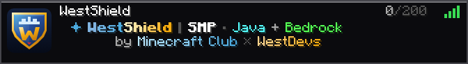

# WestShield server-list presentation

A compact original shield, blue/gold WestShield lettering, SMP/Java/Bedrock labels and a second line crediting **Minecraft Club × WestDevs**. The vector shield uses an architectural crown and W monogram. Its palette is inspired by [Westminster](https://westminster.uz/), with blue, burgundy, sky blue and gold accents; it does not reproduce an institutional logo.

The preview is rendered from the actual Java status component using local game glyphs. Client resource packs may change typography. No game font assets or reference brandbook are redistributed.

## Installation

- Use the Paper distribution of MiniMOTD 2.2.5. The upstream download and SHA-512/SHA-256 are pinned in `minimotd-lock.json`; the unchanged MIT-licensed upstream binary is not vendored here.
- Install `main.conf` and `plugin_settings.conf` under `plugins/MiniMOTD/`. Install `server-icon.png` both at the server root and as `plugins/MiniMOTD/icons/westshield.png`. Its required size is 64 × 64 PNG.
- Merge the two properties from `server.properties.example` into the existing server properties, preserving every other setting and the existing world name/seed.
- Merge the `motd` section from `bedrock-motd.example.yml` into the installed Geyser configuration. The explicit Bedrock text preserves supported colors without quoting Java JSON components. Player counts still pass through from the real server.
- Merge the TAB header section from `tab-header.example.yml`; no permissions or gameplay rules change.
- Back up current settings and icon, stop cleanly, install and start the server. Do not install duplicate MOTD handlers.

## Player capacity and validation

`max-players=200` changes native admission. MiniMOTD does **not** override the maximum and does not add fake online players. Bedrock's fallback maximum is also 200, with actual player-count passthrough enabled.

The validation receipt covers native `list` reporting a maximum of 200, public Java/Bedrock counts, both team credits, RGB/legacy formatting and exact favicon pixels after Java PNG re-encoding. Access controls and existing world/combat/map policies remain intact. The count limit is configuration acceptance, not a 200-client performance benchmark; hosting resources/tariff were not changed.

Upstream: [MiniMOTD](https://github.com/jpenilla/MiniMOTD), [configuration](https://github.com/jpenilla/MiniMOTD/wiki), [native max-player setting](https://docs.papermc.io/paper/reference/server-properties/#max-players).
