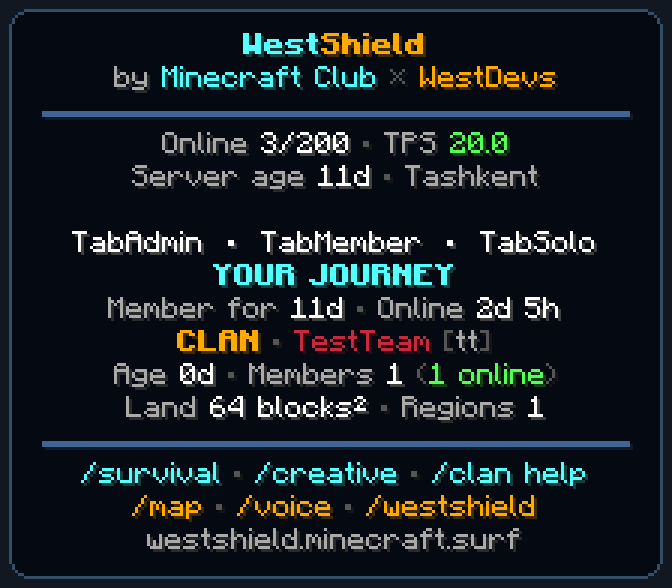

# WestShield TAB information



WestShieldTab 1.0.0 moves the server HUD into Java's TAB header/footer. The sidebar is disabled. WestShieldWelcome 1.0.1 disables automatic greetings/titles and retains on-demand `/map` and `/voice`; `/welcome` opens the information panel. AuthMe still owns registration, login, reminders and all authentication policy.

The panel shows the real online/max-player count, one-minute TPS capped at 20, server age, personal membership age, online duration, and the current clan's name/color, age, member count, authenticated online members, polygon area and number of regions. It reveals no positions, compass directions or player tracking. Useful commands appear as short reminders; TAB text is not a clickable menu.

## Time and history

- `Asia/Tashkent` is explicit in the adapter and hosting `TIME_ZONE`.
- The original server setup date is **2026-10-14**. It is independent of restarts, rebranding, world resets and Minecraft's day counter.
- Server, personal and clan ages are elapsed **calendar days** in Tashkent. The starting calendar date is `0d`; the value changes at local midnight. No wall-clock time is displayed.
- Personal age uses the earliest available Bukkit first-played and Plan registration for this server. Playtime reads Plan's saved sessions plus its current session; AFK and all dimensions count as time online. Output is whole `Xd Yh`, with hours from 0 through 23. Minutes/seconds are not displayed.
- Plan reads run asynchronously, using its existing read-only Query API and server UUID. No direct database writes, imports, statistic resets or new time-tracking database are introduced. Historical reads refresh every 30 seconds; in-session display advances between samples. Unavailable history is not fabricated as zero.
- AuthMe gates personal/clan data and the information command. A read result is bound to the admitted connection/authentication cycle; disconnect, logout and a replacement login cannot inherit a pending result.

## Clan land

WestShieldClanTerritories **1.0.3** exposes a main-thread, read-only `landSummary(Clan)` API. Area is the sum of the actual horizontal polygons in **square blocks**, not bounding boxes or volume. Region interiors already cannot overlap. Fractional square blocks are retained to one decimal; loaded world UUIDs and current clan incarnations are checked. Retired worlds and disbanded/recreated clans do not inherit area. Renames retain their existing territory identity. Clan land remains informational, with no new protection or permissions.

## Java and Bedrock

Java: hold **TAB**. `/westshield` (alias `/serverinfo`) opens the same information on demand; `/welcome` forwards to it when the adapter is enabled.

Bedrock: use **`/westshield`** to open a native Floodgate/Cumulus information form with the same values and command reminders. There is no automatic popup. Bedrock cannot display Java's TAB header/footer: [Geyser explicitly ignores that packet](https://github.com/GeyserMC/Geyser/blob/master/core/src/main/java/org/geysermc/geyser/registry/PacketTranslatorRegistry.java). Bedrock text uses its supported color palette; Java and the existing browser map retain the clan's exact RGB.

## Build and install

Use the exact tested Purpur 26.2 libraries/plugins: TAB 6.2.0, Plan 5.8 build 3638, AuthMe 6.0.1, Floodgate/Geyser and SimpleClans 2.19.2-westshield.1. Build the territory API first. Compile with one current version of each plugin on the classpath; use a dedicated dependency directory if the server copy still contains older API JARs.

```sh
python3 westshield/territories/build.py --server-root /path/to/server
# Put the resulting territory JAR and the built SimpleClans JAR in /path/to/current-api.
python3 westshield/english/build.py --server-root /path/to/server --dependency-directory /path/to/current-api --only WestShieldTab
python3 westshield/english/build.py --server-root /path/to/server --only WestShieldWelcome
javac --release 25 -cp westshield/english/build/WestShieldTab-1.0.0.jar -d /tmp/tab-checks westshield/tab/tests/TimeFormatsChecks.java
java -cp /tmp/tab-checks:westshield/english/build/WestShieldTab-1.0.0.jar TimeFormatsChecks
```

Back up before a clean stop. Replace the old welcome and territory JARs, add WestShieldTab, retain their data directories and merge the supplied TAB configuration. Never install old/new copies together. Do not install test probes. The source defaults are in `english/adapters/tab/config.yml`; the server launch date is an operator-maintained historical anchor, not a dynamically inferred uptime.

`/westshield status` requires `westshieldtab.admin` (operator by default) and reports readiness, timezone, launch date and read counters without exposing player histories. Ordinary `/westshield` requires the default-true `westshieldtab.use` permission and successful authentication.

## Verification

[verification.json](verification.json) records the exact installed artifacts and scoped acceptance. Native Java protocol tests cover login/logout, actual colored TAB packets, the absence of sidebar objectives and automatic greetings, Plan history, a real clan and a concave 64-square-block polygon, shared form rendering, custom placeholders after a TAB reload, and persistence after an actual server restart. Time tests cross Tashkent midnight and a leap day. Existing geometry/storage checks run against territory 1.0.3.

The preview is rendered from the captured native header/footer with illustrative fictional player rows and local Minecraft glyphs. Game font files are not redistributed. Java protocol and form-payload checks do not establish physical Bedrock/controller GUI behavior or a 200-player load benchmark. Earlier test-harness failures are retained privately and are not overwritten as passes.
