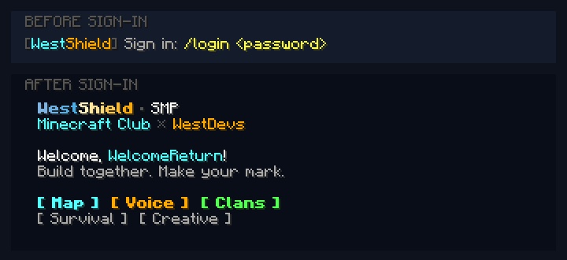

# WestShield authenticated welcome



WestShieldWelcome 1.0.0 provides one private, colored welcome after AuthMe login, automatic registration/login or session restoration. A brief matching title is shown only for automatic greetings. It contains the server/team identity and a compact menu, with no automatic URL/password tutorial dump.

## Player commands

- `/welcome`: show the menu again without replaying the title.
- `/map`: show the map link on demand.
- `/voice`: show the website and separate voice-password setup on demand. No player password is read, collected or stored by this plugin.

Java menu labels have command click actions. Floodgate players receive visible typed commands because Bedrock chat does not retain Java click metadata. Both paths use the same public map/voice URLs. The normal survival/creative/clan handlers retain all their own permissions and policies.

## AuthMe configuration

Merge `settings.example.yml` into the owning plugins' existing configuration and merge the selected fields in `authme-messages.example.yml` into the English message pack. Do not replace complete private configuration files with these snippets.

- AuthMe retains concise colored sign-in/register requests, repeated every 30 seconds instead of five. Timeouts, registration settings, wrong-password kicks, password policy, account data and command restrictions do not change.
- Disable the old AuthMe welcome and stock success lines to avoid duplicate cards. Its private/broadcast policy remains private.
- Disable only SimpleVoice-Geyser's automatic join reminder; voice authentication and audio transport stay unchanged.

The plugin requires AuthMe and optionally integrates with Floodgate. Every greeting/helper checks the actual AuthMe authenticated state. Completion events are moved to the main thread; queued events collapse into one task per player. Quit/logout reset state, and a bound player-reference check prevents an old connection from receiving a delayed greeting. Player placeholders are unparsed literals. There are no force-login, account, permission, world, inventory or network write APIs in this adapter.

Operator diagnostic: `/westshieldwelcome status`. Permission `westshieldwelcome.admin` defaults to operators; ordinary menu/link access uses `westshieldwelcome.use` and still requires authentication.

## Build and acceptance

```sh
python3 westshield/english/build.py --server-root /path/to/purpur --only WestShieldWelcome
```

Source/resources are under `westshield/english/adapters/welcome`. The exact artifact hash and scoped checks are in `verification.json`. Keep an offline rollback backup before installing the JAR/config changes and restart cleanly. Never upload the test observer to production.

The isolated run uses real non-OP Java protocol clients and real AuthMe authentication. It checks wrong-password rejection/kick, returning/new users, registration/login event deduplication, private delivery, manual menu/links, logout/login, title delivery, literal placeholders, English output for Russian clients and the Bedrock command layout. Existing credentials/whitelist/operators and world/combat rules are verified separately on production. The screenshot is rendered from those native chat components; game font files and private test credentials are not redistributed.
